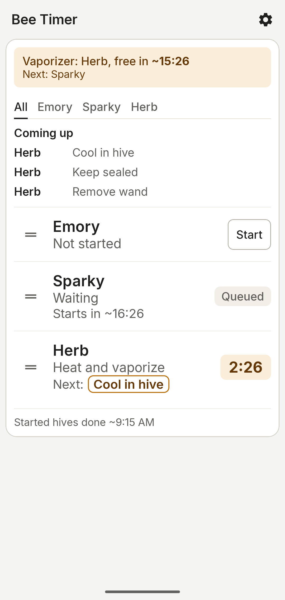
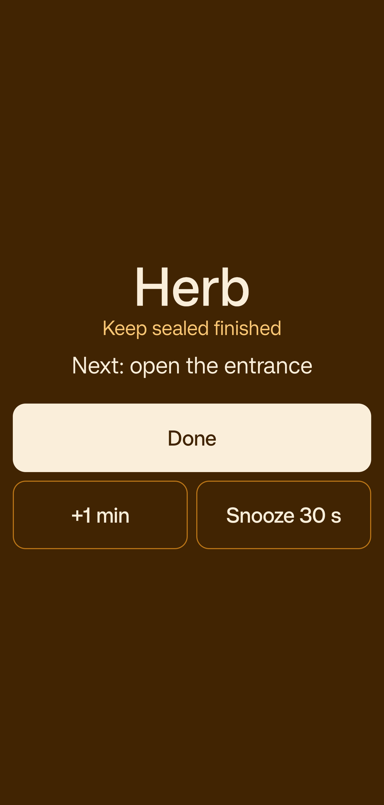
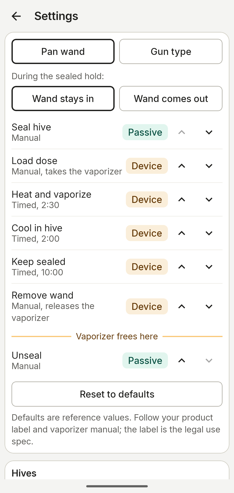

# Bee Timer

Bee Timer times oxalic acid vaporization (OAV) across several hives when you have one vaporizer. Each hive runs
the same steps with its own alarms, and the app makes sure only one hive has the vaporizer at a time.

Durations are reference defaults. Follow your product label and vaporizer manual; the label is the legal use spec.

## Screenshots

| All hives | Alarm | Steps |
|---|---|---|
|  |  |  |

More in [docs/screenshots/](docs/screenshots/). The approved mockups are in [docs/mockups/](docs/mockups/).

## Install

Android only for now. Steps are in [docs/INSTALL.md](docs/INSTALL.md), and the file is on the
[Releases page](https://github.com/MechEng70/beetimer/releases).

## What's in 0.1.0 (alpha)

- Up to 5 hives with your own names, like Emory, Herb and Sparky, in the order you treat them (drag to reorder)
- Two presets, OAV pan wand and OAV gun type. For the pan wand, choose whether the wand stays in or comes out during the sealed hold
- A step editor: rename steps, change times, move steps, and mark where the vaporizer is taken and released
- One vaporizer shared between hives: a queue, and a "Vaporizer free: Herb is next" alert when it is the next hive's turn
- Hives sealed and waiting don't hold the vaporizer, so the next hive can start
- A planning view: what comes next across all hives, with countdowns, and when the started hives will be done
- Loud alarms that show over the lock screen, with Done, +1 min and Snooze 30 s. They use the alarm volume, so they ring on silent and in Do Not Disturb. With the app open, the alarm screen opens straight away
- Timers that survive the app closing, the screen going off and a phone restart

## Coming next

Planned, not promised.

- Add and delete steps in the step editor
- Session history
- A timeline chart of the hives on the All tab
- More than one vaporizer
- Dark theme for the main screens
- iOS: later.

## Privacy

There is no account, no server and no network access. Your hives and settings stay on your phone.

## License

MIT. See [LICENSE](LICENSE).

Building it yourself: see [docs/DEVELOPING.md](docs/DEVELOPING.md). Phone test script: [docs/MANUAL-TEST.md](docs/MANUAL-TEST.md).
End-to-end tests: [docs/e2e/](docs/e2e/). Where things stand: [HANDOFF.md](HANDOFF.md).
