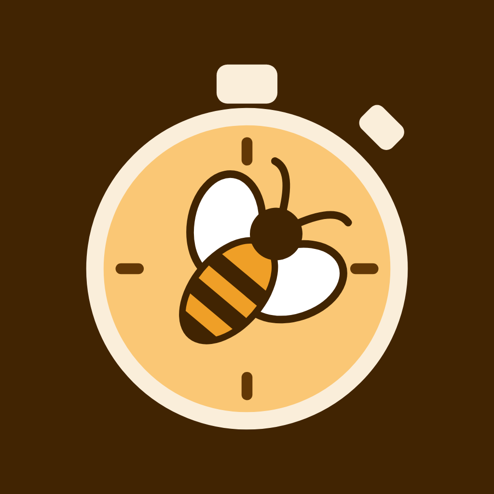

# Bee Timer

Bee Timer times oxalic acid vaporization (OAV) across several hives when you have one vaporizer. Each hive runs
the same steps with its own alarms, and the app makes sure only one hive has the vaporizer at a time.

Durations are reference defaults. Follow your product label and vaporizer manual; the label is the legal use spec.

## Screenshots

Coming with the first release. The approved mockups are in [docs/mockups/](docs/mockups/).

## Install

Android only for now. Steps are in [docs/INSTALL.md](docs/INSTALL.md), and the file is on the
[Releases page](https://github.com/MechEng70/beetimer/releases).

## What's in 0.1.0 (alpha)

- Hives with your own names, like Emory, Herb and Sparky
- Two presets, OAV pan wand and OAV gun type, with editable step times
- One vaporizer shared between hives: a queue, and a "Device free" alert when it is the next hive's turn
- Hives sealed and waiting don't hold the vaporizer, so the next hive can start
- Loud alarms that show over the lock screen, with Done, +1 min and Snooze 30 s. They use the alarm volume, so they ring on silent and in Do Not Disturb
- Timers that survive the app closing, the screen going off and a phone restart

## Coming next

Planned, not promised.

- Add, delete and reorder steps in the template editor
- Session history
- iOS: later.

## Privacy

There is no account, no server and no network access. Your hives and settings stay on your phone.

## License

MIT. See [LICENSE](LICENSE).

Building it yourself: see [docs/DEVELOPING.md](docs/DEVELOPING.md). Phone test script: [docs/MANUAL-TEST.md](docs/MANUAL-TEST.md).
